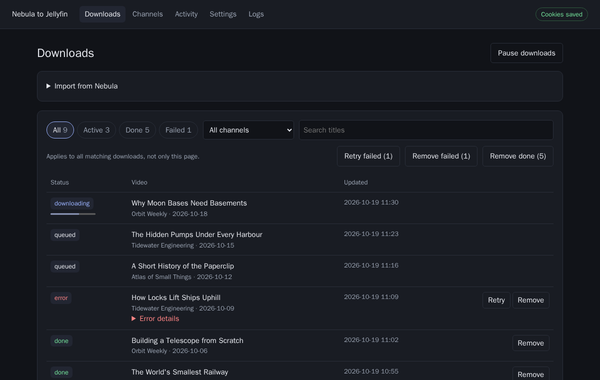

# Nebula to Jellyfin

Download Nebula videos and channels into a library for Jellyfin, including titles, descriptions, images and subtitles.



**An active, paid [Nebula](https://nebula.tv/) subscription is required.** Support Nebula and its creators as they build an independent alternative to YouTube.

## Quick start

You need Docker with Docker Compose and a cookie file exported from your logged-in Nebula browser session in Netscape format.

### 1. Create an installation directory

```sh
mkdir nebula-to-jellyfin
cd nebula-to-jellyfin
mkdir state media
```

### 2. Create `compose.yaml`

Copy the following into a file named `compose.yaml` in that directory:

```yaml
services:
  nebula-downloader:
    image: ghcr.io/karoc123/nebula-to-jellyfin:v0.1.1
    restart: unless-stopped
    init: true
    ports:
      - "8099:8000"
    volumes:
      - ./state:/data
      - ./media:/media
    stop_grace_period: 2m # Allow active network requests to finish on shutdown.
```

### 3. Start the application

```sh
docker compose up -d
```

Open **http://localhost:8099**. The application has no login; use it on a trusted private network.

### 4. Import cookies and download a video

1. Open **Settings** and upload your cookie file under **Nebula authentication**.
2. Click **Test saved cookies** and wait for a successful result.
3. Open **Downloads**, paste a Nebula video URL and click **Queue import**.
4. Wait for the download to show **done**.

Your video and its metadata are now in `media/library/`. **Error details** and
**Logs** explain failed downloads. After correcting the cause, click **Retry**.

## Add channels

Paste a channel URL in Downloads or Channels and choose a selection:

- **Future only** saves the existing catalog without downloading it.
- **Latest N** downloads the most recent number of videos you enter.
- **All videos** downloads the channel's current catalog.

Enable **Subscribe to channel** to download new uploads automatically. Open a channel to select older videos later. Daily checks run at `04:00` by default; change the time and timezone in Settings, or click **Check subscriptions now**.

Downloads run one at a time. Completed videos are skipped on later imports. Failed videos require an explicit retry. Interrupted downloads resume after a restart. Defaults prefer HEVC up to 1080p with English and German subtitles; download preferences can be changed in Settings.

## Connect Jellyfin

1. Make this installation's `media/library` folder available to Jellyfin. If
   Jellyfin runs in Docker, add a read-only bind mount for that folder to its
   container.
2. In Jellyfin, add a library with content type **Shows** and select that folder.
3. Enable the **NFO** metadata reader and disable online metadata and image
   providers for this library.
4. Scan the library.

Each channel appears as a show, with publication years as seasons. Keep the show's metadata unlocked so Jellyfin can read metadata for later additions. Only `media/library` belongs in Jellyfin; `media/.nebula-work` holds unfinished work and must stay outside the scan root.

## Choose where files are stored

The two directories next to `compose.yaml` contain:

| Directory | Contents |
| --- | --- |
| `state/` | Database, authentication cookies, settings and logs |
| `media/` | Finished library and temporary download files |

To store videos somewhere else, replace `./media` in Compose with an existing host directory, for example `/mnt/videos:/media`. Leave the container path `/media` unchanged. Prepare the directory on the host and make it writable for the container user; see [Permission denied](#permission-denied). Keep `state/` on local storage.

## Update and back up

To update, change the image version in `compose.yaml`, then run:

```sh
docker compose pull
docker compose up -d
```

Settings shows application and yt-dlp update availability separately. Both are installed through new container images.

For a backup, run `docker compose stop`, copy both `state/` and `media/`, then run `docker compose start`. Include the unfinished files under `.nebula-work`. Protect the backup because it contains cookies. Restore both directories from the same backup with the matching image version; older images cannot use a newer database schema.

## Troubleshooting

View container logs with `docker compose logs -f`, or open **Logs** in the UI.

| Problem | What to do |
| --- | --- |
| Cookie test fails or downloads return 401/403 | Export fresh cookies while logged into Nebula and confirm the account has an active subscription, then import them and retry |
| Permission denied | Make `state/` and `media/` writable for the container UID; see below |
| Download failed | Expand Error details, fix the cause and click Retry |
| Downloads paused | Media storage was unreachable; fix the mount, then click Resume downloads |
| New videos do not appear in Jellyfin | Check its folder mapping and NFO reader, then scan the library |
| Update status is unknown | The release check could not complete; downloads continue normally |

### Permission denied

The image runs as UID/GID `1000:1000`. Docker does not translate UIDs for bind mounts, so `state/` and `media/` must be writable by that user. If your host user has a different UID/GID, set the container user and the directory ownership to the same values.

1. Find your host UID and GID:

   ```sh
   id -u
   id -g
   ```

2. If the output is not `1000` and `1000`, add the matching user to `compose.yaml`:

   ```yaml
       user: "1001:1001" # Replace with the UID and GID from step 1.
   ```

3. Set the owner of both directories:

   ```sh
   cd nebula-to-jellyfin
   sudo mkdir -p state media
   sudo chown -R "$(id -u):$(id -g)" state media
   ```

   If you use a different host directory for `/media`, run the same `chown` on that directory instead of `media`.

4. Start the container and verify the effective user and write access:

   ```sh
   docker compose up -d
   docker compose exec nebula-downloader id
   docker compose exec nebula-downloader sh -c 'test -w /data && test -w /media && echo writable'
   ```

   The `id` output must show the UID/GID from step 1. The second command must print `writable`.

If files were previously created under a different UID, run the `chown -R` command again. Jellyfin only needs read access to `media/library`, which the default file modes allow.

## Build from source

From a checkout of this repository:

```sh
mkdir -p state media
docker compose up -d --build
```

Open http://localhost:8099 and follow step 4 of the quick start.

For development outside Docker, install Python 3.13+, uv 0.13.1+ and ffmpeg:

```sh
uv sync --locked
uv run ruff check .
uv run ruff format --check .
uv run pytest -q
DATA_DIR="$PWD/state" MEDIA_DIR="$PWD/dev-media" uv run uvicorn app.main:app --port 8099
```

Use one application process. Database migrations run automatically before work starts. Dependencies are locked in `uv.lock`.

To check container startup and Jellyfin compatibility in isolated test libraries:

```sh
docker build -t nebula-verification .
python3 tools/container_probe.py --image nebula-verification
uv run python tools/jellyfin_probe.py
```

GitHub Actions execution and arm64 runtime verification remain outstanding before the first release.

MIT licensed; see [LICENSE](LICENSE).
